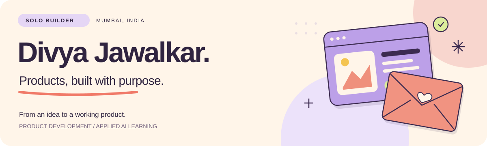

<strong>I’m Divya, a solo builder making useful products and playful web experiences.</strong> 
I like taking an idea from “what if?” to something people can actually try.

<a href="https://www.linkedin.com/in/divyajawalkar22/"><strong>Let’s work together ↗</strong></a> &nbsp; · &nbsp; Open to internships, freelance projects and collaborations.

## What I’m building

<table>
<tr>
<td width="50%" valign="top">

<h3>Myroll ↗</h3>

An Android photo organizer in the making. A calmer way to move, favorite, tag and sort the photos already on your phone.

<strong>In development</strong> · Android product + interactive launch website

<a href="https://github.com/divyajawalkar22/myroll-showcase">Explore the project</a> · <a href="https://myroll-website.vercel.app/">Visit the website</a>

</td>
<td width="50%" valign="top">

<h3>I Love Love ↗</h3>

A digital letter studio for the people you’re glad exist. Write, decorate, choose an opening and share a little love.

<strong>Try the web app</strong> · Creative tools + interactive storytelling

<a href="https://github.com/divyajawalkar22/i-love-love-showcase">Explore the project</a> · <a href="https://ilovelove.vercel.app/">Visit the studio</a>

</td>
</tr>
</table>

These are product showcases. Their implementation stays private.

## My approach

**Make it useful. Make it feel good. Keep improving it.**

I care about the small interactions, the visual details and the path from an idea to a working product. This space follows what I’m building now.

**Tools I use:** TypeScript · React · Next.js · JavaScript · HTML & CSS · Python

<strong>Earlier experiments & learning</strong>

Before these products, I explored websites, small utilities and interface ideas. A few pieces from that journey:

- [Discover Hampi](https://github.com/divyajawalkar22/humpy) — an early tourism website and visual-design experiment.
- [Ecommerce](https://github.com/divyajawalkar22/ecommerce) — product browsing, search and a browser-saved cart.
- [Currency Converter](https://github.com/divyajawalkar22/curencyconverter) — a Python desktop utility built with Tkinter.
- [Diwali greetings](https://github.com/divyajawalkar22/diwali_page_index) — a small creative page with animated wishes.

These are earlier learning projects, separate from the products I’m developing today.

---

<strong>Have an internship, a product idea or a project that needs a builder?</strong> 
<a href="https://www.linkedin.com/in/divyajawalkar22/">Say hello on LinkedIn ↗</a>

